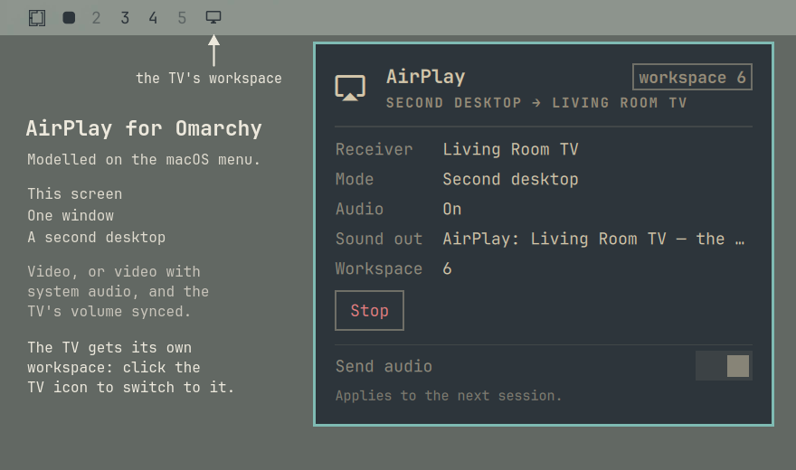
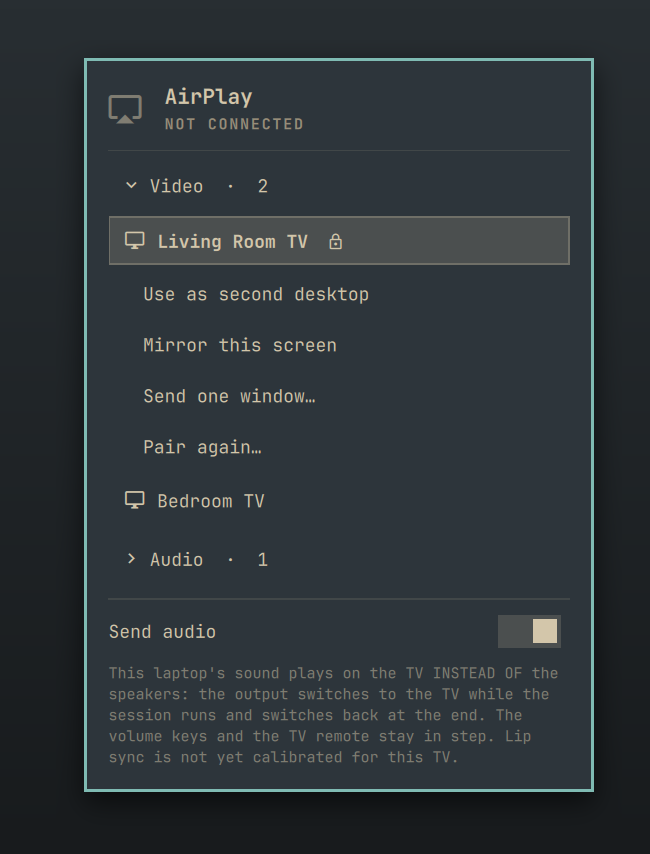
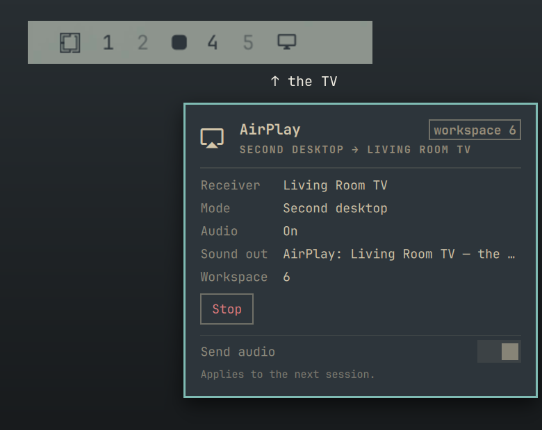
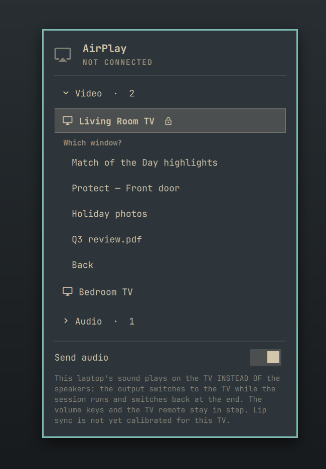
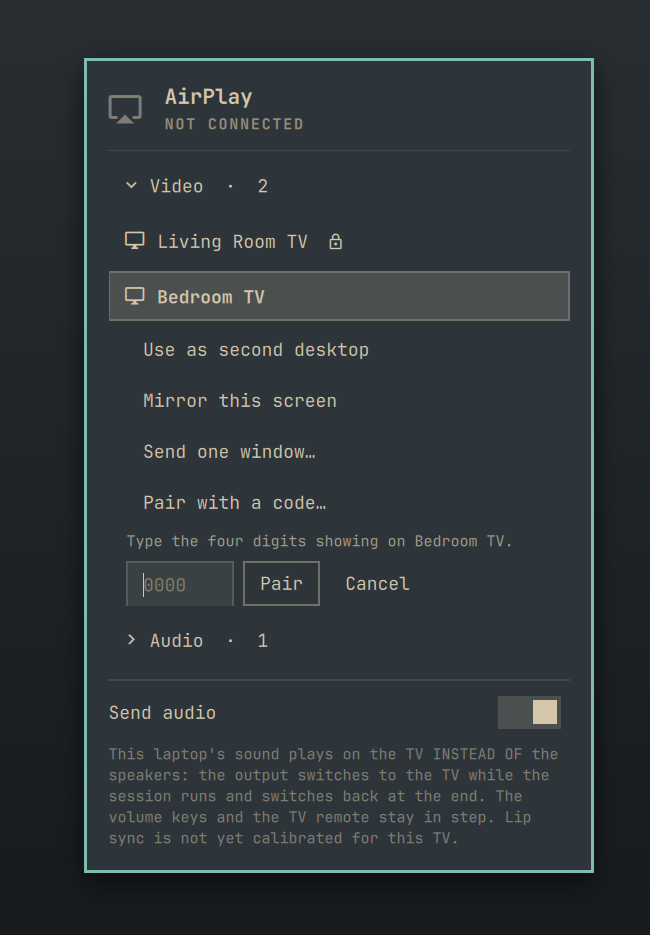

# omarchy-workspaces

The TV in your workspace bar: Omarchy's workspace indicator, plus a TV icon for
the workspace that is on your television.



## What you get

You know the AirPlay menu on a Mac? Click it, pick the TV, and your screen's up
on the wall. This brings that to Omarchy. It isn't a wrapper around somebody
else's tool. It's a sender written from scratch in Rust for Wayland and
Hyprland, tested against a real TV, and built to be fast and stay out of your
way.

**Pick a TV right from the bar.** Your TVs show up in the AirPlay menu. Click
one, then choose what it should show.



**Use the TV as a second desktop.** This is the one you'll use most. The TV
gets its own workspace, and it turns up as a little TV icon at the end of your
workspace bar. Click it to hop over, drag a window across, and keep working on
the laptop while the TV plays.



**Or send just one window.** A video, a camera feed, your slides: the rest of
your screen stays yours.



**Or mirror the whole screen** when everyone needs to see what you see.

**Sound comes too.** Turn on *Send audio* and your laptop's sound moves over to
the TV, the way a Mac hands it over. The TV's volume follows your volume keys,
and your speakers come back when you stop.

**Pair once.** Some TVs ask for a code the first time. Type the four digits
from the TV and you're set.



**It's quick.** The picture never leaves the GPU: it goes straight from the
screen into the hardware video encoder. That's about 5 ms from a frame being
drawn to it being ready to send, on around 7 % of one CPU core.
[The numbers, and how to check them on your machine.](https://github.com/jonspinks/omarchy-airplay#performance)

**It tidies up after itself.** Pairing keys stay private to your account,
every build is pinned to a tested commit, and the menu only ever stops or
cleans up things it started itself.

### What it works with

Tested end to end on a Samsung Frame, video and sound. Other AirPlay 2 TVs
should work but haven't been tried yet. An Apple TV won't: it needs Apple's
FairPlay, which this doesn't do. Speakers on their own (HomePod, Sonos) aren't
supported yet; sound goes to the TV along with the picture.

## The three pieces

AirPlay for Omarchy comes in three parts, and you want all three:

| Piece | What it does for you |
|-------|----------------------|
| [omarchy-airplay](https://github.com/jonspinks/omarchy-airplay) | **The sender.** Finds your TVs, pairs, and streams your screen, a window or a whole desktop, with sound. |
| [omarchy-cast](https://github.com/jonspinks/omarchy-cast) (`blacksheep.airplay`) | **The AirPlay menu** in your bar: pick a TV, pick a mode, pair, stop. |
| [omarchy-workspaces](https://github.com/jonspinks/omarchy-workspaces) (`blacksheep.workspaces`, listed as *Cast Workspaces*) | **The TV in your workspace bar**, so the second desktop is one click away. |

Omarchy plugins can't pull each other in, so you install each one yourself.
[omarchy-cast's README](https://github.com/jonspinks/omarchy-cast#install) walks
through all three in order.

## This piece: the TV in your workspace bar

Installs as the bar widget `blacksheep.workspaces` (listed as *Cast Workspaces*),
and replaces Omarchy's stock `omarchy.workspaces`. It started as a clone of the
stock widget (`omarchy plugin clone omarchy.workspaces`), so it survives
`omarchy update`, and it behaves the same until a session starts. When AirPlay's
**Second desktop** puts a workspace on the TV, that workspace's button becomes
a TV icon and moves to the right-hand end of the row, whatever its number. Click
it to switch there. Without the sender there is no TV workspace, so this is
simply the stock indicator.

## Install

```bash
omarchy plugin add https://github.com/jonspinks/omarchy-workspaces --enable
omarchy plugin disable omarchy.workspaces   # it replaces the stock widget
omarchy restart shell
```

Install the sender and omarchy-cast first; their steps are in [omarchy-cast's
README](https://github.com/jonspinks/omarchy-cast#install). This widget needs
them to be useful, but not to run: without a headless `AIRPLAY-*` output it
behaves exactly like the stock indicator.

## Remove

```bash
omarchy plugin remove blacksheep.workspaces
omarchy plugin enable omarchy.workspaces    # bring the stock widget back
omarchy restart shell
```

The widget itself stores nothing and writes no files, so there is nothing else to
clean up.

## Why

[omarchy-airplay](https://github.com/jonspinks/omarchy-airplay) has an Extend
mode: it creates a Hyprland headless output named `AIRPLAY-<workspace>` and
puts a workspace on it, so that workspace lives on the TV rather than on any
screen in front of you. Drag a window there and it plays on the television
while you carry on working on the laptop.

The stock widget labels every button with its id and nothing else, so there is
no way to tell which of them is the one on the TV. Hence the glyph.

## What changed from the stock widget

`Workspaces.qml` is Omarchy 4.5's stock widget, which keeps its per-monitor
workspaces, its layout glyph and click-to-cycle on the shown workspace, and
wheel scrolling. The changes on top:

- `isAirplay(id)` is true when the workspace's monitor name starts with
  `AIRPLAY-`. It reads `HyprlandWorkspace.monitor`, a live property, so this
  needs no polling, no state file and no help from the daemon.
- A TV workspace renders `󰍹` (U+F0379 nf-md-television) in place of its number,
  keeps full opacity while empty (it is a live destination, not a spare
  number), and has a tooltip.
- TV workspaces sit at the end of **every** bar's row, after a gap, whatever
  their id. They are on no physical monitor, so no bar would otherwise own
  them, and on 4.5 their id may be anywhere: per-monitor workspaces give each
  new output, headless ones included, a block of ten of its own.
- Clicking a TV workspace focuses it by id, never through the per-monitor
  slot, so it never lands on the clicked bar's own monitor.
- The bar also refreshes when an output is added or removed.

## Notes

- Nothing here is AirPlay-specific beyond the `AIRPLAY-` prefix. Any headless
  output named that way gets the glyph.
- When Omarchy changes its own widget, carry the change over: diff
  `/usr/share/omarchy/shell/plugins/bar/widgets/Workspaces.qml` against this
  file. Last rebased on Omarchy 4.5.0-3.

## License

MIT — see [LICENSE](LICENSE). `Workspaces.qml` is derived from Omarchy's stock
widget, © David Heinemeier Hansson, also MIT; that notice is kept in the
license file.
